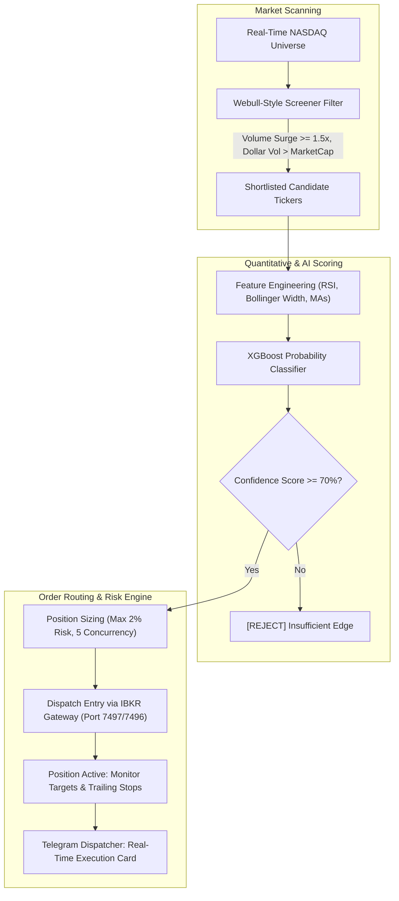
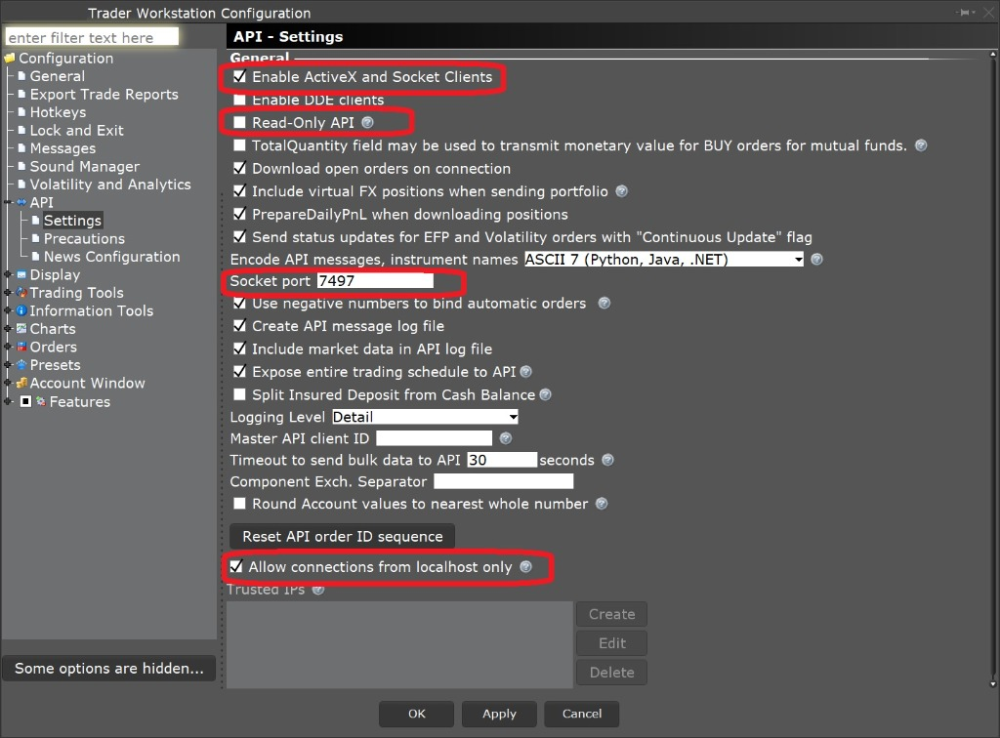

# 🧠 Intelligent Intraday Breakout Trading Bot (AI & NASDAQ Momentum)

[](https://python.org)
[](https://xgboost.readthedocs.io)
[](https://interactivebrokers.com)
[](https://core.telegram.org/bots)
[](https://opensource.org/licenses/MIT)

> An institutional quantitative intraday breakout trading system engineered for **NASDAQ momentum equities**. Combines high-velocity stock screening (volume surges, dollar volume expansion, Bollinger width), a trained **XGBoost machine learning probability classifier**, tiered capital risk protection, and automated **Interactive Brokers (IBKR)** order routing with real-time Telegram alerts.

---

### 💼 Need Custom Quantitative Trading Bots, ML Predictors, or Broker Automation?
I build institutional trading software, low-latency market screeners, predictive ML models, and broker execution systems.
* 💬 **Telegram:** [@JanzebBlockdev](https://t.me/JanzebBlockdev)
* 💼 **Fiverr Profile:** [Verified Quantitative Developer (Fiverr)](https://tinyurl.com/2wruxnsx)
* 📧 **Email:** `jahanzaibchanna70@gmail.com`

---

## 📑 Table of Contents
1. [Key Architectural Highlights](#-key-architectural-highlights)
2. [End-to-End Decision Pipeline](#-end-to-end-decision-pipeline)
3. [Stock Screening & Quantitative Filters](#-stock-screening--quantitative-filters)
4. [Machine Learning Prediction Engine](#-machine-learning-prediction-engine)
5. [Multi-Tiered Risk & Profit Ladder](#-multi-tiered-risk--profit-ladder)
6. [Project Structure](#-project-structure)
7. [Prerequisites & Installation](#-prerequisites--installation)
8. [Configuration & Environment Setup](#-configuration--environment-setup)
9. [Explore Other Quantitative Projects](#-explore-other-quantitative-projects)
10. [Disclaimer](#-disclaimer)

---

## 🚀 Key Architectural Highlights

* **High-Surge Momentum Screener:** Screens real-time NASDAQ equities matching explosive volume surges ($\ge 1.5\times$ 3-month average), dollar volume expansion, and tight volatility bands.
* **XGBoost Probability Filter:** Computes live multi-indicator feature vectors (RSI, Bollinger Band Width, candle color ratios, moving average alignments) and enforces a strict $\ge 70\%$ ML success probability threshold before triggering orders.
* **Tiered Dynamic Stop-Losses:** Automatically assigns risk limits scaled to equity price categories (3% for \$5 stocks, 5% for penny tiers).
* **Multi-Stage Profit Scaling:** Automatically locks in profits at $+10\%$ (breakeven stop), $+25\%$ (trail lock), and engages a $5\%$ trailing stop for remaining runners.
* **Real-Time Telegram Operations Dispatcher:** Instant mobile alerts on fills, stops, profit locks, and automated 15-minute P&L equity reports.

---

## 🏛️ End-to-End Decision Pipeline



---

## 🔍 Stock Screening & Quantitative Filters

* **Price Range:** \$0.30 – \$5.00 (High-velocity small/micro caps).
* **Volume Surge:** $\ge 1.5\times$ average 3-month volume.
* **Market Capitalization:** \$10M to \$3B.
* **RSI Momentum:** Dynamic range between $50$ and $80$.
* **Dollar Volume Expansion:** Dollar Volume > Market Cap (Surge accumulation).
* **Candle Ratio:** Minimum 60% green candles over last 20 5-minute bars.

---

## 🤖 Machine Learning Prediction Engine

The integrated XGBoost classification model assesses trade success probability using real-time feature vectors:
* **Momentum:** Relative Strength Index (RSI 14) + rate-of-change.
* **Volatility:** 5-minute ATR and Bollinger Band width compression / expansion.
* **Trend Cohesion:** Moving averages alignment (MA10, MA30, EMA5, EMA10).
* **Scoring Guard:** Trades are rejected if the ML confidence probability is $< 70\%$.

---

## 🛡️ Multi-Tiered Risk & Profit Ladder

### Dynamic Stop-Loss Thresholds:
| Price Tier | Initial Risk Stop |
| :--- | :--- |
| **Below \$1.00** | 5.0% Stop Loss |
| **\$1.00 – \$3.00** | 4.0% Stop Loss |
| **\$3.00 – \$5.00** | 3.0% Stop Loss |

### Profit-Taking Scaling:
* **Target 1 (+10% Gain):** Move Stop Loss to Entry (Guaranteed Breakeven).
* **Target 2 (+25% Gain):** Move Stop Loss to $+10\%$ (Guaranteed Profit Lock).
* **Target 3 (+35%+):** Activate $5\%$ Trailing Stop for max trend capture.
* **Market Close Flatten:** Hard position liquidation at 15:50 ET (10 minutes before market close).

---

## 📁 Project Structure

```
intelligent-intraday-breakout-trading-bot/
├── main.py                 # Bot execution entry point
├── config.py              # Strategy parameters & risk configurations
├── requirements.txt       # Dependencies
├── env_example.txt        # Environment variables template
├── README.md             # Technical documentation
├── src/                  # Source modules
│   ├── main_bot.py       # Orchestration engine
│   ├── data/             # Stock screener & Polygon/IBKR feeds
│   ├── analysis/         # Indicators & feature extraction
│   ├── ai/               # XGBoost inference model
│   ├── trading/          # Risk manager & order execution
│   └── notifications/    # Telegram dispatcher
├── models/               # Pre-trained ML model checkpoints
└── logs/                 # Execution & trade logs
```

---

## 🛠️ Installation & Setup

1. **Clone the repository:**
   ```bash
   git clone https://github.com/jahanzaib-codes/intelligent-intraday-breakout-trading-bot.git
   cd intelligent-intraday-breakout-trading-bot
   ```

2. **Setup virtual environment & install requirements:**
   ```bash
   python -m venv .venv
   source .venv/bin/activate  # On Windows: .venv\Scripts\activate
   pip install -r requirements.txt
   ```

3. **Configure Environment:**
   ```bash
   cp env_example.txt .env
   ```
   Add your IBKR socket port (`7497`/`7496`), Telegram Bot Token, and Chat ID.

4. **Configure Interactive Brokers TWS / Gateway:**
   * In TWS, go to **Global Configuration $\rightarrow$ API $\rightarrow$ Settings**.
   * Enable ✅ **"Enable ActiveX and Socket Clients"**.
   * Uncheck ❌ **"Read-Only API"**.
   * Ensure Socket Port matches `.env` (`7497` Paper / `7496` Live).

<p align="center">
  
</p>

---

## ▶️ Execution Command

Ensure Interactive Brokers Gateway or TWS is running, then execute:

```bash
python main.py
```

---

## ⭐ Explore Other Quantitative Projects

* 🧠 **[Interactive Brokers AI 0DTE Options Bot & GUI](https://github.com/jahanzaib-codes/ibkr-ai-trading-bot-gui)** — ML-driven options execution terminal with XGBoost and Tkinter.
* 📉 **[IBKR Automated Trailing Stop Orders](https://github.com/jahanzaib-codes/ibkr-trailing-orders)** — CSV batch trailing stop limit order dispatcher with loss prevention.
* 📊 **[Real-Time NASDAQ Screener & ATR Bot](https://github.com/jahanzaib-codes/RealTime-ATR-Screener-Trader)** — Polygon.io WebSocket screener and chandelier execution engine.
* 📱 **[IBKR Telegram Bot & TradingView Webhook](https://github.com/jahanzaib-codes/ibkr-telegram-trading-bot)** — Webhook listener and remote Telegram trading terminal.
* ⚡ **[Solana Pump.fun 0-Block Sniper Bot](https://github.com/jahanzaib-codes/solana-pumpfun-sniper-bot)** — Ultra low-latency meme coin sniper with Jito MEV bundles.

---

## ⚠️ Disclaimer

*This trading software is engineered for educational, algorithmic research, and demonstration purposes. Intraday trading carries significant financial risk. Thoroughly backtest and paper trade on IBKR demo accounts prior to live capital deployment.*

---
*Maintained by **Jahanzaib** ([@jahanzaib-codes](https://github.com/jahanzaib-codes))*
